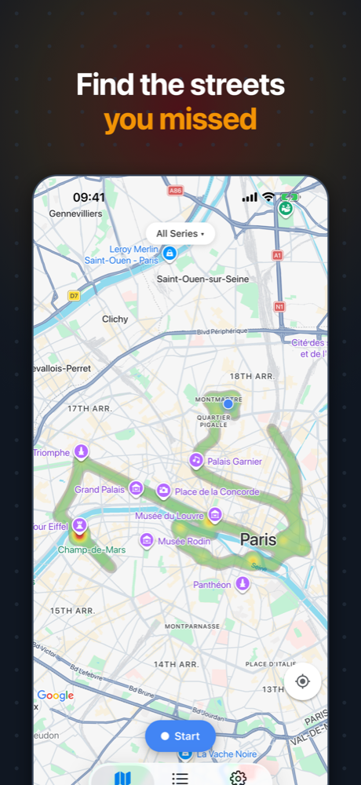
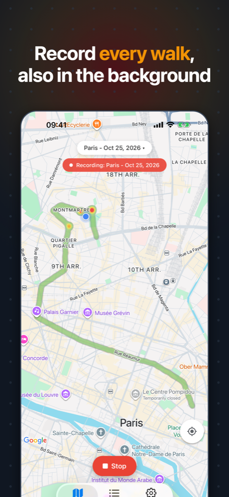

<div align="center">


# Heatmap: See What You Missed

**Find the streets you never walked.**

<a href="https://apps.apple.com/app/id6830774275"></a>
&nbsp;

&nbsp;


<br />
<br />





</div>

## What it does

You go on a weekend city trip, or on vacation to another country. You walk around, you drive to different places, and you see a lot. But what did you **not** see? Which streets did you never walk? Which parts of the city haven't you seen yet?

Heatmap records where you go and shows it on the map:

- 🔥 **Your hotspots:** the places where you spent the most time show in red.
- 🌫️ **Your blind spots:** the streets and areas where you never went stay empty.
- 🧭 **Where to go next:** look at the empty areas, and go there to see something new.

Start a recording when you go out, and stop it when you come back. The app saves your location in the background, also when the screen is locked. Each trip is a series. Look at one trip, or at all of them together.

## Privacy first

Your location history is personal. The app is made so that it stays with you.

- 🔒 **No account, no sign-up.** Open the app and start.
- 📱 **Your data stays on your iPhone.** The app stores the recorded points in a local SQLite database. It has no server and no cloud sync. Nobody, also not the developer, can see your locations.
- 🚫 **No analytics, no ads, no tracking.** The app has no analytics SDK, no advertising SDK and no tracking.
- 📍 **Location only when you want it.** The app asks only for the "While Using the App" permission. It records in the background only while a recording runs, which you start and stop yourself. iOS shows the location indicator during the recording.
- 🗑️ **You are in control.** Delete one series, or select many and delete them together, at any time. When you delete the app, iOS deletes all its data.
- 👀 **Open source.** You can read all the code in this repository.

Two system services receive data from the app:

- **Google Maps** shows the map. To load the map tiles, the Google Maps SDK sends requests to Google, which receives technical data such as the visible map area. Your recorded points are not sent: the app draws the heatmap on the device.
- **Apple's geocoder** gives the city name for a new series (for example "Berlin, Germany"). For this, iOS sends the start position of the series to Apple one time.

Read the full [privacy policy](docs/privacy-policy.md).

## Features

### Record

- ⏺️ Start and stop a recording with one tap.
- 🏷️ Each recording is a series with an automatic name from the city and the date, for example "Prenzlauer Berg - Oct 25, 2026".
- ➕ Continue an older series to add more points to it.
- 🌙 Records in the background and when the screen is locked.
- ⚙️ Set how often the app saves a point: by time (5 s to 5 min, also when you stay at one place) and by distance (5 m to 500 m).

### Explore

- 🗺️ See all your series on one map, or select one series.
- 🔥 The heatmap goes from green to yellow to red, so the places where you stayed longest stand out.
- 🚶 Points count less when you move fast. A street that you walked shows stronger than a street that you drove through.
- 📊 Open a series to see its map, its number of points and its time range.
- ✏️ Rename series. Select series to merge or delete them.

## Development

The app uses [Expo](https://expo.dev) (SDK 54) with React Native, [Expo Router](https://docs.expo.dev/router/introduction/), [react-native-maps](https://github.com/react-native-maps/react-native-maps) with the Google provider, `expo-location` with `expo-task-manager` for the background recording, and [Drizzle ORM](https://orm.drizzle.team) on `expo-sqlite`.

### Requirements

- Node.js and pnpm
- Xcode and the iOS Simulator
- A Google Maps API key for the Maps SDK for iOS

### Set up

```sh
pnpm install
```

Put the Google Maps key in `.env.local`. Git ignores this file:

```sh
GOOGLE_MAPS_IOS_API_KEY=<your key>
```

Restrict the key to the Maps SDK for iOS and to the bundle ID of your build. EAS builds read the key from the EAS environment variable with the same name.

### Run

The app uses native modules, so it needs a development build. Expo Go does not work.

```sh
pnpm ios          # build and run on the iOS Simulator
pnpm start        # start the bundler for an existing development build
```

### Test

```sh
pnpm test         # unit tests with Vitest
pnpm typecheck    # TypeScript
```

### Other commands

```sh
pnpm db:generate  # generate a Drizzle migration after a schema change
pnpm prebuild     # generate the native iOS project again
```

The app icon comes from a script: `swiftc -O scripts/generate-icon.swift -o /tmp/generate-icon && /tmp/generate-icon assets`.

## Support

Found a problem or have an idea? [Open an issue](https://github.com/zirkelc/heatmap/issues). See also the [support page](docs/support.md).
